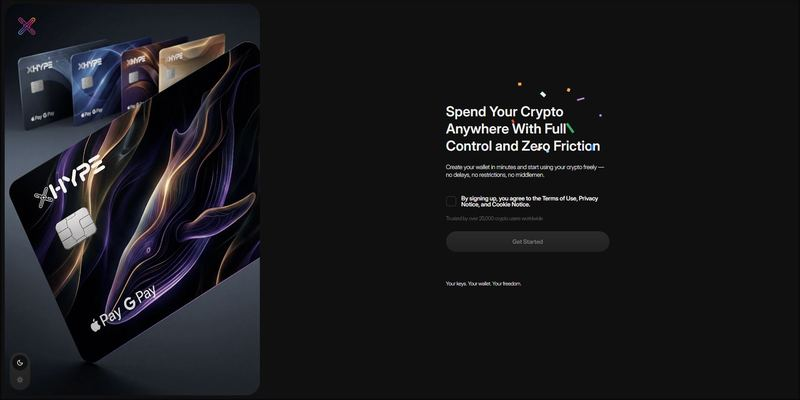
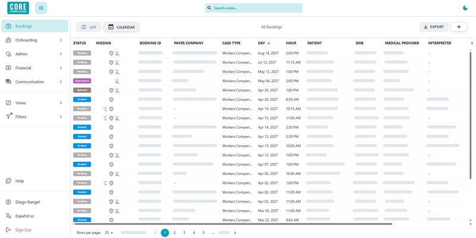

<picture>
  <source media="(prefers-color-scheme: dark)" srcset="assets/hero-night.svg">
  <source media="(prefers-color-scheme: light)" srcset="assets/hero-day.svg">
  
</picture>

<b>I lead teams that build fast, scalable, measurable web and mobile products.</b>

<table>
  <tr>
    <td align="center"><h3>8+</h3>years of experience</td>
    <td align="center"><h3>10+</h3>developers led</td>
    <td align="center"><h3>−80%</h3>hotel booking time</td>
    <td align="center"><h3>5 → 0</h3>critical day-1 errors per release</td>
  </tr>
</table>

## How I work

- **Lead, hands-on.** I manage 10+ engineers (hiring, 1:1s, growth plans) and still ship code from frontend to DevOps.
- **Quality is the default.** 80%+ coverage, E2E and CI gates on every pull request.
- **AI-assisted delivery.** I lead my team's Claude Code workflow: agent orchestration, custom skills and AI review on every PR.

## Stack

**Frontend** &nbsp;

**Backend** &nbsp;

**Cloud & AI** &nbsp;

## Featured work

<table>
  <tr>
    <td width="50%" valign="top">
      
      <h3>SuperWallet</h3>
      Travel bookings in a crypto wallet, −80% booking time.  
      <a href="https://www.diegorangel.dev/en/projects/superwallet">Read case study →</a>
    </td>
    <td width="50%" valign="top">
      
      <h3>BE - Booking Engine</h3>
      Booking-to-billing for US medical interpreting.  
      <a href="https://www.diegorangel.dev/en/projects/be-booking-engine">Read case study →</a>
    </td>
  </tr>
</table>

Open-source projects are pinned below.

  <picture>
    <source media="(prefers-color-scheme: dark)" srcset="https://raw.githubusercontent.com/Starloss/Starloss/output/snake-dark.svg">
    <source media="(prefers-color-scheme: light)" srcset="https://raw.githubusercontent.com/Starloss/Starloss/output/snake-light.svg">
    
  </picture>

## Let's talk

Open to lead roles: remote, or relocation.

[-2f6b4f?style=flat)](https://www.diegorangel.dev/cv-diego-rangel-en.pdf)

---

Versión en español → [diegorangel.dev](https://www.diegorangel.dev/)
